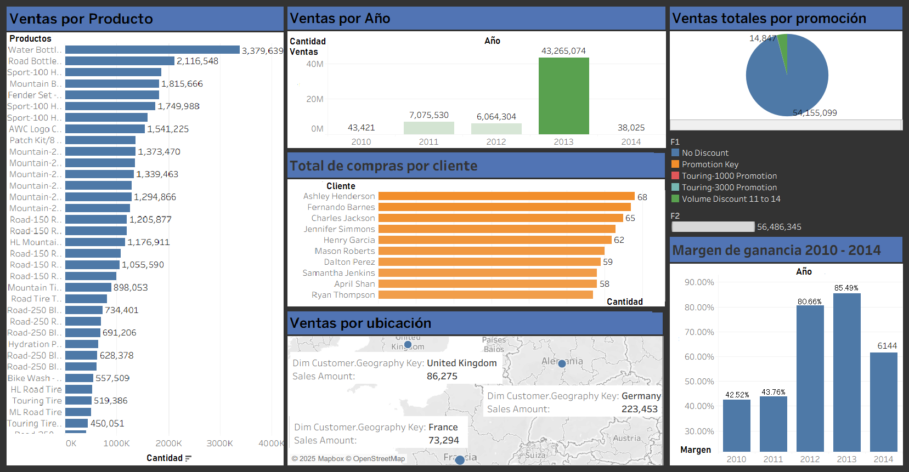

# Solución de inteligencia de negocios con AdventureWorks

Proyecto académico de inteligencia de negocios que recorre el camino completo de los datos: se cargan las ventas por internet de AdventureWorks a un data warehouse con un **ETL en SSIS**, se modelan en un **cubo OLAP en SSAS** y se muestran en **dashboards de KPIs en Tableau**, organizados con el marco del Balanced Scorecard.



## Flujo de los datos

```
AdventureWorks2022 (OLTP)  ──►  ETL (SSIS)  ──►  AdventureWorksDW2022  ──►  Cubo (SSAS)  ──►  Dashboards (Tableau)
   Sales.SalesOrderHeader                          dbo.FactInternetSalesNew
```

## Qué incluye

| Carpeta | Contenido |
|---|---|
| `etl/` | Proyecto de SSIS que carga las ventas a la tabla de hechos |
| `cubo/` | Proyecto de SSAS con el cubo multidimensional |
| `dashboards/` | Los 4 KPIs en Tableau y una captura del dashboard |
| `sql/` | Scripts para generar ventas nuevas en la base de ejemplo |

## ETL (SSIS)

El paquete toma las órdenes de `Sales.SalesOrderHeader` en AdventureWorks2022 y las carga en `dbo.FactInternetSalesNew` del data warehouse. En el flujo de datos se usan:

- **Origen OLE DB** para leer las órdenes
- **Columnas derivadas** para calcular los campos de la tabla de hechos, como los montos, el costo total del producto y las llaves de fecha
- **Búsquedas (lookup)** para obtener las llaves de las dimensiones
- **División condicional** para separar las filas con error
- **Destino OLE DB** en la tabla de hechos

Las filas que fallan se guardan con su código y columna de error para poder revisarlas.

## Cubo (SSAS)

El cubo `Adventure Works DW2022` se construye sobre la tabla de hechos **Fact Internet Sales**.

- **Medidas:** Order Quantity, Unit Price, Extended Amount, Discount Amount, Total Product Cost, Sales Amount, Tax Amt y Freight
- **Medidas calculadas:** `ProfitMargin`, `DaysToShip` y `SalesAmountYTD`
- **Dimensiones:** Product, Customer, Promotion, Currency, Sales Territory, Customer - Sales Territory y Date, que se usa tres veces como Order Date, Due Date y Ship Date
- **Perspectivas:** `VentasPorProducto`, `VentasPorCliente`, `VentasPorTerritorio` y `Promociones`

## Dashboards (Tableau)

Cada KPI está en su propio libro y se conecta al cubo.

| Libro | KPI |
|---|---|
| `KPI 1` | Perspectiva financiera: ventas totales por producto |
| `KPI 2` | Ventas por segmento de cliente y ubicación, con el margen de ganancia 2010 - 2014 |
| `KPI 3` | Aprendizaje y crecimiento: ventas por año |
| `KPI 4` | Perspectiva financiera: ventas totales por promoción |

## Scripts SQL

- `01_ventas_nuevas_adventureworks.sql` inserta ventas nuevas en `Sales.SalesOrderHeader` para contar con datos más recientes
- `02_ordenes_internet_adicionales.sql` genera 100 órdenes de internet adicionales con fechas posteriores a 2014-06-30

> Estos scripts modifican la base de ejemplo. Conviene ejecutarlos en una copia.

## Cómo reproducirlo

1. Instalar SQL Server y restaurar las bases **AdventureWorks2022** y **AdventureWorksDW2022** ([guía de Microsoft](https://learn.microsoft.com/es-es/sql/samples/adventureworks-install-configure)).
2. Abrir `etl/ProyectoII_ETL.sln` en Visual Studio con las extensiones de Integration Services, ajustar el servidor en las conexiones (están en `localhost`) y ejecutar el paquete.
3. Abrir `cubo/ProyectoII_IAN_AS.sln` con las extensiones de Analysis Services, implementar y procesar el cubo.
4. Abrir los libros de `dashboards/` con Tableau Desktop. Se conectan al cubo local, así que antes hay que tenerlo implementado.

Los datos de AdventureWorks son una base de ejemplo ficticia de Microsoft.

## Tecnologías

SQL Server · SSIS · SSAS · MDX · Tableau
